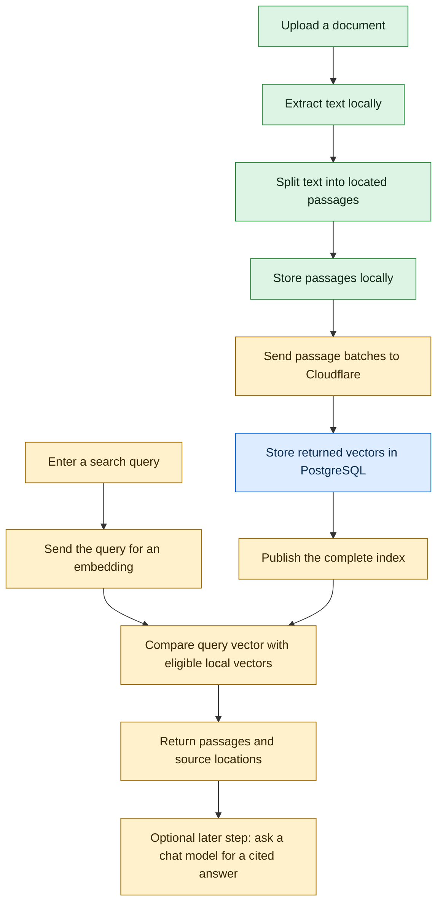
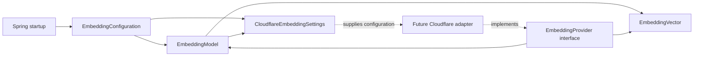
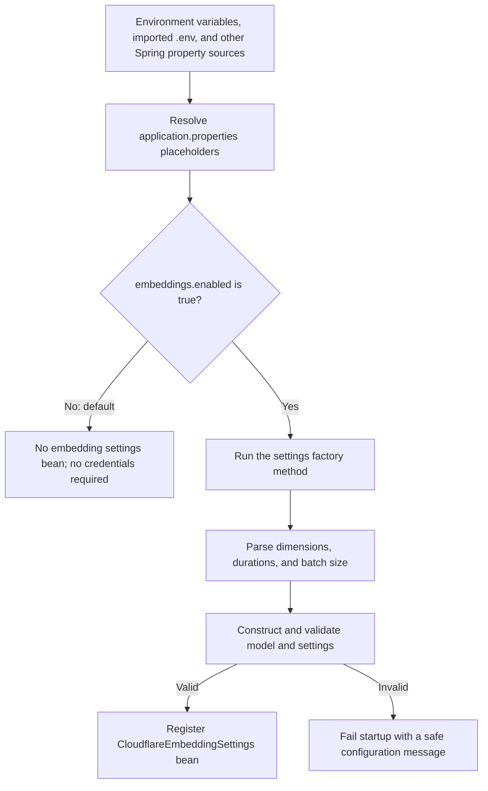
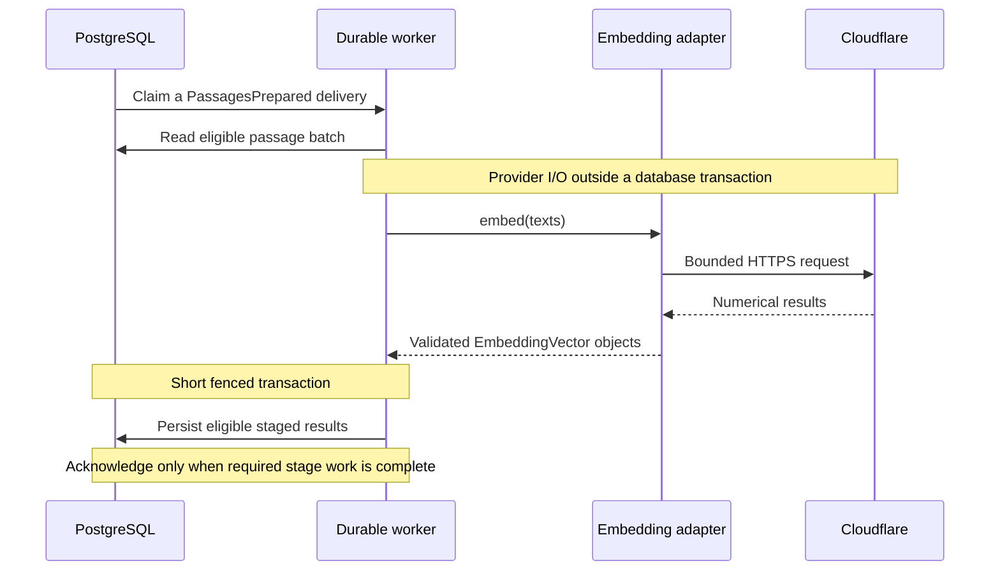
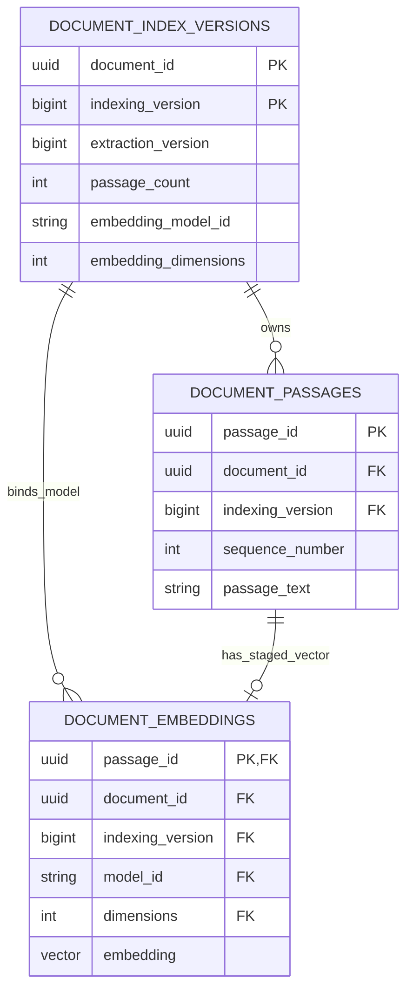
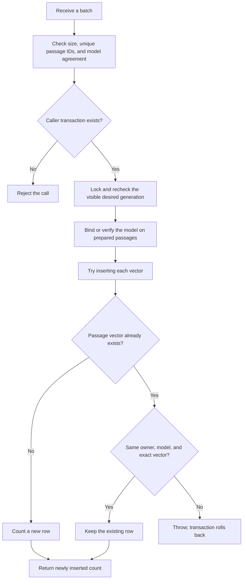

# Understanding embeddings: the contract and local storage

This is a personal learning guide that grows with **US-03-03**. It currently covers:

1. `feat(embeddings): configure the embedding model contract`
2. `feat(embeddings): persist versioned pgvector embeddings`

The first commit defines the rules for requesting and accepting embeddings. The second adds database storage for supplied vectors. **The current upload workflow still does not call Cloudflare or generate/store embeddings automatically.**

The diagrams use Mermaid. Open this file in a Markdown viewer with Mermaid support to render them. The tables and text examples explain the same ideas if your viewer displays the diagram source.

## 1. Where embeddings fit in the product

An embedding is a list of numbers produced from text by a trained model. It lets us compare text numerically to find passages with similar meaning. This is different from asking a chat model to write an answer.

Imagine your notes contain:

> Plants convert sunlight into chemical energy.

You search for:

> How do plants get energy from light?

The wording differs. Embedding both texts with the same model can put them near each other in its numerical representation. This is useful evidence for retrieval, but it does not establish that a passage answers every part of a question or that a generated answer is true.

### The complete intended workflow



Green means implemented through passage preparation. Blue means the vector schema/storage adapter exists, but the workflow does not populate it yet. Yellow means later work. The upload form does not wait for an embedding request. The future durable worker will do that processing in the background.

The text version is:

```text
UPLOAD:  file -> text -> passages -> embeddings -> stored vectors -> complete index
SEARCH:  query ------------------> embedding  -> local similarity search
ANSWER:  question + retrieved passages -------> chat model -> cited answer
```

Passage embeddings are normally computed during indexing and then reused. A new search query still needs its own embedding. Asking for a written answer adds a separate chat request.

## 2. What “1024 dimensions” means

Our supported model contract is:

```text
model ID:    @cf/baai/bge-m3
dimensions:  1024
```

“1024 dimensions” means **one text input produces a vector containing 1024 numbers**. It does not mean 1024 words, passages, tokens, or requests.

Here is an invented three-number example to make the shape readable:

| Input | Toy vector |
|---|---|
| A passage about plants using sunlight | `[0.90, 0.30, 0.10]` |
| A question about plants getting energy from light | `[0.88, 0.31, 0.12]` |
| A passage about replacing a bicycle tire | `[0.10, 0.05, 0.95]` |

These numbers are illustrative, not real model outputs or measured retrieval results. The individual positions are learned coordinates; we cannot simply label one position “plants” and another “bicycles.”

In the application, each row would contain 1024 components. Similarity search will compare the direction of vectors using cosine similarity.

**Matching the number of components is necessary but insufficient.** Two different models may both produce 1024 numbers while using different coordinate systems. Indexing and query embedding must use the same compatible model configuration. Changing that configuration requires deliberate reindexing of the stored passages.

## 3. The new files and their separate jobs

Paths below are relative to `src/main/java/dev/secondbrain/`.

| File | Question it answers | Responsibility |
|---|---|---|
| [EmbeddingModel.java](../src/main/java/dev/secondbrain/embeddings/EmbeddingModel.java) | Which numerical representation do we accept? | Validate the supported model ID/dimension pair |
| [EmbeddingVector.java](../src/main/java/dev/secondbrain/embeddings/EmbeddingVector.java) | Is this returned vector safe to use? | Validate and protect numerical components |
| [EmbeddingProvider.java](../src/main/java/dev/secondbrain/embeddings/EmbeddingProvider.java) | What must an embedding service be able to do? | Define the shared Java interface |
| [CloudflareEmbeddingSettings.java](../src/main/java/dev/secondbrain/embeddings/CloudflareEmbeddingSettings.java) | Which account, destination, and limits are configured? | Hold validated settings and protect credentials in diagnostics |
| [EmbeddingConfiguration.java](../src/main/java/dev/secondbrain/config/EmbeddingConfiguration.java) | When and how does Spring create those settings? | Read external values and construct the settings bean |



The dotted arrows describe future implementation. There is currently no Cloudflare adapter object to receive those settings.

This separation lets document indexing and future search use the same embedding interface without putting HTTP code inside document repositories or controllers.

## 4. `EmbeddingModel`: a small Java record with rules

The declaration is:

```java
public record EmbeddingModel(String id, int dimensions) {
    // Constants and validation follow in the actual file.
}
```

A record is a concise way to represent a value. Java generates its accessors, equality, hash code, and a textual representation. Its fields cannot be reassigned after construction.

For example:

```java
var model = new EmbeddingModel("@cf/baai/bge-m3", 1024);
String name = model.id();
int count = model.dimensions();
```

`var` means Java infers the local variable's type from the expression on the right. `model` still has the fixed type `EmbeddingModel`; Java has not made it dynamically typed.

The compact constructor in the real file runs whenever someone calls `new EmbeddingModel(...)`. It rejects anything except the explicitly supported pair. An unsupported value throws `IllegalArgumentException`, so an invalid model object cannot escape the constructor.

The constants use `public static final`:

- `public`: other packages can access them.
- `static`: they belong to the class, so no object is needed to read them.
- `final`: the constant reference/value cannot be reassigned.

Defining this pair does not download a model or contact Cloudflare. It defines our compatibility rules. BGE-M3 is the initial supported candidate; a live response and retrieval quality have not been verified by this commit.

## 5. `EmbeddingVector`: protect the result at the boundary

A future provider response becomes an `EmbeddingVector` only if it satisfies these rules:

| Check | Why it matters |
|---|---|
| The model and component array exist | Required data must not be missing |
| Component count matches the model | A 768-number result cannot enter a 1024-dimensional index |
| Every component is finite | `NaN` and positive/negative infinity cannot be treated as ordinary coordinates |
| At least one component is nonzero | A zero vector has no direction for cosine similarity |

The constructor stores a copy of the input array. The accessor also returns a copy.

```text
Caller's input array --clone--> private stored array --clone--> caller's returned array
```

Why are two copies important? In Java, `final float[] values` prevents replacing the array reference, but it does not prevent changing `values[0]`.

Without copying, a caller could supply a valid array, then change a component to `NaN` after validation. Or a caller could modify the array returned by `values()` and silently change the object's internal state.

The test demonstrates that both paths are protected:

```java
var components = new float[1024];
components[0] = 0.125f;
var vector = new EmbeddingVector(model, components);

components[0] = Float.NaN;
var returned = vector.values();
returned[0] = Float.POSITIVE_INFINITY;

// The vector's internal first component is still 0.125f.
```

The `f` suffix makes a numeric literal a Java `float`. Without it, a decimal literal such as `0.125` is a `double`.

`toString()` deliberately returns only something like `EmbeddingVector[dimensions=1024]`. It does not expose the coordinates. Even a protected textual representation is not a reason to log entire objects by default.

## 6. `EmbeddingProvider`: an interface is a promise

The interface declares:

```java
EmbeddingModel model();
List<EmbeddingVector> embed(List<String> inputs) throws InterruptedException;
```

Read that as:

1. A provider can tell us which model it uses.
2. It can receive a list of texts and return a list of vectors.
3. The vectors must correspond to the texts in the same order.
4. Its work can be interrupted, for example during shutdown.

`List<String>` means a list whose elements are strings. `List<EmbeddingVector>` means a list whose elements are vectors. These are Java generics: the compiler checks the element types.

The method has no implementation body here. A future class will use `implements EmbeddingProvider` and supply the actual HTTP behavior. **Declaring the interface does not execute a request or register a Spring bean.**

In NestJS terms, this resembles an application-facing TypeScript interface plus the idea of a provider implementation. One difference is that Java interfaces exist as runtime types; Spring can inject a registered implementation by its Java interface type. We still need to register that implementation as a bean. This commit has not done so.

The interface separates responsibilities; it does not introduce multiple external providers. The selected external service remains Cloudflare.

## 7. How configuration reaches the Java objects

Spring already imports `.env` as a properties file through:

```properties
spring.config.import=optional:file:.env[.properties]
```

The new application properties include:

```properties
secondbrain.embeddings.enabled=${SECONDBRAIN_EMBEDDINGS_ENABLED:false}
secondbrain.embeddings.model=${CLOUDFLARE_EMBEDDING_MODEL:}
secondbrain.embeddings.dimensions=${CLOUDFLARE_EMBEDDING_DIMENSIONS:0}
```

For `${NAME:fallback}`, Spring looks up `NAME` in its configuration sources and uses the fallback if it is absent. An empty fallback after `:` means an empty string.

The import makes the uppercase names available even when they are entries in our `.env` properties file rather than exported shell variables. An ordinary `.env` file is not automatically imported by every Java application; our explicit Spring setting enables this behavior.



Malformed numeric/duration input can fail during parsing, before an object constructor runs. This also prevents startup from accepting that configuration.

### The Spring annotations in this file

| Annotation | Meaning here | Approximate NestJS comparison |
|---|---|---|
| `@Configuration` | This class declares Spring-managed object factories | A module's provider configuration |
| `@Bean` | Register the returned object in Spring's application context | A `useFactory` provider |
| `@ConditionalOnProperty` | Load this configuration only when the property has the required value | Conditional/dynamic module configuration |

The main application scans its packages during startup. That is how it discovers `config.EmbeddingConfiguration`; we do not call it from a controller.

Spring supplies `Environment` to the factory method. This is dependency injection: Spring provides an existing dependency rather than requiring the method to construct one. `Environment` gives access to resolved application configuration.

The factory explicitly calls `new EmbeddingModel(...)` and `new CloudflareEmbeddingSettings(...)`. **Only the returned settings object is registered by this `@Bean` method.** Constructing the nested model object does not automatically register a separate model bean.

`proxyBeanMethods = false` tells Spring not to create proxies for direct calls between bean factory methods. This configuration does not need that interception.

## 8. Settings, defaults, and limits

| Value | Default | Validation when enabled |
|---|---|---|
| Enabled flag | `false` | Only explicit `true` loads this configuration |
| Cloudflare account ID | Empty | Exactly 32 hexadecimal characters |
| API token | Empty | 1–4096 printable ASCII characters, without spaces/control characters |
| Model | Empty | Exactly `@cf/baai/bge-m3` |
| Dimensions | `0` | Exactly `1024` |
| Connect timeout | `2s` | At least 100 ms, at most 10 seconds |
| Request timeout | `30s` | At least the connect timeout, at most 60 seconds |
| Batch size | `8` | Between 1 and 32 inputs |

The account ID and token identify/authenticate the account; they are unrelated to document IDs and correlation IDs.

Account/token checks validate their format only. They do not verify that the account exists, the token works, permissions are sufficient, or the account uses the free plan.

The default model/dimension values are intentionally invalid for an enabled configuration. Enabling it requires an explicit model choice. Leaving the feature disabled needs no credentials or model choice.

For the future adapter, connect timeout will bound connection establishment, request timeout will bound the request operation, and batching will limit how many texts enter one request. **Right now these values are validated settings; no transport exists to enforce them.** A batch of eight texts means eight vectors, not one average vector and not necessarily eight network requests.

The endpoint method constructs one account-scoped HTTPS destination on `api.cloudflare.com`. It does not send anything. Credentials are excluded from `toString()` and validation errors. The tests check both logs and exception text for synthetic secret sentinels.

## 9. How this connects to our durable events

Current passage processing already commits the stored passages and `PassagesPrepared` fact with its delivery acknowledgment. There is no embedding consumer registered for that fact yet.

The intended next stage will work like this:



This diagram describes planned embedding integration, not a handler installed by this commit. Exact multi-batch completion is part of the later implementation. A partial batch set must not become a searchable index.

We keep network I/O outside the write transaction so a slow service does not hold database locks while we wait. Before committing results, the worker must recheck its lease and the document/index version and visibility. A deleted or superseded document must not receive stale results.

If a process crashes after the provider responds but before results commit, the request may be repeated. Database writes must be idempotent, but that does not make the external request exactly once. Repeating a request can consume the free allowance again.

## 10. What is finished after these two commits, and what is not

| Capability | State after this commit |
|---|---|
| Explicit model/dimension compatibility rules | Implemented |
| Validated vectors with defensive copies | Implemented |
| Shared provider interface | Implemented; no implementation installed |
| Opt-in configuration and safe validation | Implemented |
| HTTP calls and provider response validation | Not implemented |
| Vector storage in PostgreSQL/pgvector | Schema and guarded adapter implemented; no embedding consumer calls it yet |
| Durable embedding consumer and batch recovery | Not implemented |
| Complete-index activation and semantic search | Not implemented |
| Live model/account/quality/free-allowance verification | Not performed |

The first commit is useful because the following code can rely on agreed model, data, and configuration rules. It does not establish that live inference works or that retrieval is good.

The planned HTTP integration uses Java's built-in HTTP client and the existing Jackson JSON library. We have not added Spring AI or a paid OpenAI account. Cloudflare's “OpenAI-compatible” endpoint describes a request/response protocol; Cloudflare is still the service receiving the request.

Our free-only requirement also depends on staying on the correct Cloudflare account plan. Java configuration cannot guarantee an account's billing settings. The provider allowance is finite, and later code must handle its exhaustion safely.

## 11. How to study and check the first commit

Read the five production files in the order listed in section 3. Then open:

- [EmbeddingVectorTest.java](../src/test/java/dev/secondbrain/embeddings/EmbeddingVectorTest.java) for mutation protection, invalid dimensions, nonfinite components, and zero vectors.
- [EmbeddingConfigurationTest.java](../src/test/java/dev/secondbrain/config/EmbeddingConfigurationTest.java) for Spring startup, opt-in behavior, external-property mapping, and safe invalid-configuration failures.

From the repository root:

```sh
./mvnw -Dtest=EmbeddingConfigurationTest,EmbeddingVectorTest test
```

These 25 test invocations use synthetic values and no provider client, account, Docker container, or live request. They are ordinary automated checks for this small slice. The full project completion check remains:

```sh
./mvnw verify
```

That also requires access to Docker and a local HTTP listener for the existing integration tests. A successful focused run does not replace those checks. You do not need to fill in real Cloudflare credentials to study or test this commit. Keep embeddings disabled during ordinary startup for now.

Questions to answer after reading:

1. Why does changing the model require more than changing `1024` to another number?
2. Why does a `final` array still need defensive copies?
3. Why does an interface alone never call the provider?
4. Which exact object does the `@Bean` method register?
5. Why can configuration validation pass even if an API token has expired?
6. Why could a retry consume allowance twice while storing only one logical result?

## 12. The second commit: giving vectors a safe home

We now have somewhere to put vectors supplied to the storage adapter. We have not connected that adapter to the live model or durable embedding worker.

### New files and the migration

| File | Responsibility |
|---|---|
| [V11 migration](../src/main/resources/db/migration/V11__persist_versioned_passage_embeddings.sql) | Add vector storage and enforce database relationships |
| [PassageEmbedding.java](../src/main/java/dev/secondbrain/documents/PassageEmbedding.java) | Associate one immutable vector with one stable passage UUID |
| [JdbcEmbeddingRepository.java](../src/main/java/dev/secondbrain/documents/JdbcEmbeddingRepository.java) | Store a bounded batch under document/version and transaction guards |
| [EmbeddingRepositoryIT.java](../src/test/java/dev/secondbrain/documents/EmbeddingRepositoryIT.java) | Exercise actual PostgreSQL constraints, rollback, retries, and concurrency |

The storage classes live in `documents` because passages, index generations, and deletion belong to that feature. The shared numerical model and provider interface stay in `embeddings`. Storage neither calls the provider nor knows its account/token.

`DocumentConfiguration` registers the repository bean. Its constructor receives `JdbcClient`, `JdbcIndexingRepository`, and the transaction manager. All refer to the same application datasource. Constructing this bean performs no SQL or network request. It needs no Cloudflare credentials.

### Three tables, three responsibilities



The diagram omits some existing passage/source fields for readability. `vector` here means the actual PostgreSQL column type `vector(1024)`.

- `document_index_versions` identifies a particular rebuild of a document and the extracted-text version it uses. It now also records the model/dimensions selected by its first stored batch.
- `document_passages` holds the text and source location for each stable passage ID.
- `document_embeddings` holds at most one vector for each passage ID. It repeats document/index/model identifiers so the database can check their relationship directly.

This repeated metadata is intentional. A valid passage UUID alone must not let code attach the vector to a different document or generation.

A **primary key** prevents duplicate identities. A **foreign key** checks that a referenced owner exists. A **composite foreign key** checks multiple columns together: the passage, document, and index generation must belong to the same row, and the stored model/dimension pair must match the index's binding.

The paired model fields start as `NULL`, meaning “not bound yet.” Both must be absent or both present. Binding a model also requires prepared-passage metadata. `NULL` does not mean failure, success, or a second job status; event deliveries remain our job records.

### What pgvector adds

PostgreSQL stores ordinary relational data already. The pgvector extension adds a numerical vector type and distance operations inside the same database. We do not introduce another database or vector service.

Conceptually, a row contains:

```text
passage_id:       the stable UUID of this passage
indexing_version: 7
model_id:         @cf/baai/bge-m3
dimensions:       1024
embedding:        [number, number, ... 1024 components ...]
```

The `vector(1024)` column enforces the actual number of components. The extension rejects nonfinite values, and our SQL constraint also rejects zero vectors. See the [pinned pgvector reference](https://github.com/pgvector/pgvector/blob/v0.8.7/README.md#vector-type). These database checks complement the earlier Java constructor checks; they also protect the table from invalid direct SQL.

There is a normal index on `(document_id, indexing_version)` for accessing a generation's rows. There is no approximate-nearest-neighbor search index yet, and no search endpoint. The term “indexing version” is our application generation number; it is different from a database index that accelerates queries.

### Why V11 instead of changing V10?

Flyway applies versioned migrations in order and records their checksums. Existing databases may already have V10. Editing an applied migration could make those databases fail validation and would not supply a clean upgrade path.

V11 adds the new fields/table/constraints. Existing documents and passages stay in place; existing generations start with no model binding and no embeddings. This migration does not generate vectors or backfill them through a remote service.

## 13. How one batch is stored

The repository method is:

```java
int insertBatch(IndexingVersion version,
                EmbeddingModel model,
                List<PassageEmbedding> batch)
```

It returns the number of **new rows inserted**, not the total vectors for that document and not a success/failure flag. Zero can mean every supplied vector was already stored identically.



The diagram condenses the loop. Every row in the batch is checked before the method returns. Any invalid ownership or SQL constraint failure also aborts the batch.

### Step A: validate the batch

The method accepts 1–32 items, rejects repeated passage IDs within one call, and requires each vector's model to match the supplied model. The immutable `EmbeddingVector` has already checked its numbers.

Thirty-two is the repository's fixed upper bound. The configurable default batch size of eight is a policy for the later provider/worker. One is the storage ceiling; the other is a chosen request size.

### Step B: join the caller's transaction

`PROPAGATION_MANDATORY` means an existing transaction is required. The adapter cannot quietly start and commit an independent transaction.

For example, if the caller performs:

```text
BEGIN
    store vectors
    perform another required stage write
    something fails
ROLLBACK
```

The vector rows and any newly established model binding roll back too. This will let the later worker coordinate database effects with its lease-checked completion. This commit does not implement that embedding worker or acknowledge its event.

Our adapter uses separate parameterized statements for the rows, grouped in one transaction. Each statement has a five-second query timeout; the caller still owns the overall transaction timeout. It does not send a single bulk SQL statement and does not commit each vector separately. This is bounded by at most 32 vectors per call.

### Step C: prevent stale writes

Before inserting, the adapter locks the document and checks that the requested index is still desired, its source extraction still matches, and the document is still visible/extracted. Starting a newer index, changing the source, marking deletion, or removing the document makes old work ineligible.

That lock coordinates current database state. The later event worker must additionally fence writes by its delivery lease. A document-version check does not establish lease ownership by itself.

### Step D: bind the model

The first successful batch records the model and dimensions on its index generation. Later batches must agree. The model binding and the batch rows commit together; a failed first batch leaves neither behind.

The current Java and SQL contracts support only the explicit BGE-M3/1024 pair. Supporting another pair would require deliberate code/schema changes and a new index generation, not editing a model string on an existing populated generation.

### Step E: handle retries without overwriting

The insert uses:

```sql
ON CONFLICT (passage_id) DO NOTHING
```

That alone would be insufficient: it could silently ignore a conflicting result. When an existing row is encountered, the adapter checks its owner/model and numerical equality.

| Attempt | Result |
|---|---|
| New passage ID with valid ownership | Insert it |
| Same passage ID and identical vector/model/owner | Keep the original; count zero new rows for it |
| Same passage ID with different values | Reject; roll back this call |
| Passage belongs to another document/version | Reject; roll back this call |

Example: suppose the first batch contains passages 1–8 and commits. A retry supplies the same eight results. It inserts zero new rows. A later batch for passages 9–16 can still make progress. The adapter preserves prior committed batches, while an error inside the current batch rolls that whole batch back.

If a conflicting item appears after a new item in the same call, that earlier new insert also rolls back. Existing committed rows remain unchanged. Rejecting conflicting results avoids silently mixing numerical snapshots within one generation.

### Step F: let PostgreSQL own the vector representation

The adapter serializes validated floats into a bracketed literal and binds that value as a SQL parameter. The SQL uses `CAST(:embedding AS vector)`; numerical content is not concatenated into executable SQL.

`Float.toString` gives a locale-independent representation, including scientific notation. Database tests read the stored result back as a PostgreSQL `real[]` and compare every component, so the check is independent of simply regenerating the same input literal.

The adapter does not log vector values or provider data. Its repository method does not contact Cloudflare.

### What deletion does now

`ON DELETE CASCADE` follows ownership. Physically removing a passage or its index/document removes dependent vector rows as part of the database operation. An immediate deletion marker still serves a different purpose: it excludes a document before asynchronous physical cleanup finishes.

Stored vectors from old generations are staging/history data, not automatically visible search results. Later retrieval must use the active, complete generation of a visible document.

## 14. Checking the storage slice

Run the isolated database checks with Docker available:

```sh
./mvnw -Dit.test=EmbeddingRepositoryIT,DatabaseMigrationIT verify
```

The new storage suite has 14 invocations covering multi-batch continuation through fresh JDBC collaborators, exact component round-trip, identical/conflicting retries, rollback and injected SQL failure, concurrent writers, version/document separation, cascade cleanup, stale/deleted work, batch bounds, and direct database constraints. The tests use generated vectors and an isolated PostgreSQL/pgvector Testcontainer. They require no Cloudflare account or real document uploads.

These are integration tests because locking, foreign keys, the pgvector type, and transaction rollback need real PostgreSQL behavior. Fast tests alone cannot establish those properties. The existing complete gate remains `./mvnw verify`.

At the time this section was added, the new database tests compiled but could not execute under the agent's Docker/socket restrictions. Do not treat compiled test cases or a successful fast suite as proof of current PostgreSQL success. The implementation plan records subsequent verification results.

For a read-only look at staging in your normal database after applying V11:

```sql
SELECT i.document_id, i.indexing_version, i.passage_count,
       i.embedding_model_id, i.embedding_dimensions,
       count(e.passage_id) AS stored_vectors
FROM document_index_versions i
LEFT JOIN document_embeddings e
    ON e.document_id = i.document_id
    AND e.indexing_version = i.indexing_version
GROUP BY i.document_id, i.indexing_version, i.passage_count,
         i.embedding_model_id, i.embedding_dimensions
ORDER BY i.document_id, i.indexing_version;
```

For now, `stored_vectors = 0` and empty model fields are expected in the ordinary upload workflow. Nothing invokes the new adapter from that workflow yet. Passing storage tests populates the test container, not your normal library database.

## References and related notes

The source files are the authority for current behavior. [The local architecture](../.task/architecture.md) owns design decisions and provider research; [the implementation plan](../.task/IMPLEMENTATION_PLAN.md) owns scope and verification status. [The development guide](../docs/development.md#embedding-configuration) lists implemented configuration settings.

Provider/model sources checked during implementation: [Cloudflare compatible endpoint](https://developers.cloudflare.com/workers-ai/configuration/open-ai-compatibility/), [BGE-M3 model specification](https://huggingface.co/BAAI/bge-m3), and [Cloudflare free-plan pricing rules](https://developers.cloudflare.com/workers-ai/platform/pricing/). Model documentation and pricing are external facts; recheck them before live inference. No live inference was performed to create this guide.
