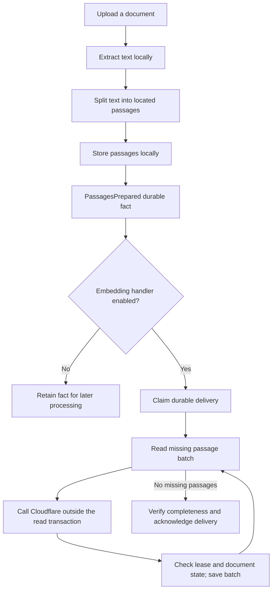
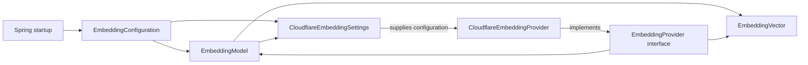
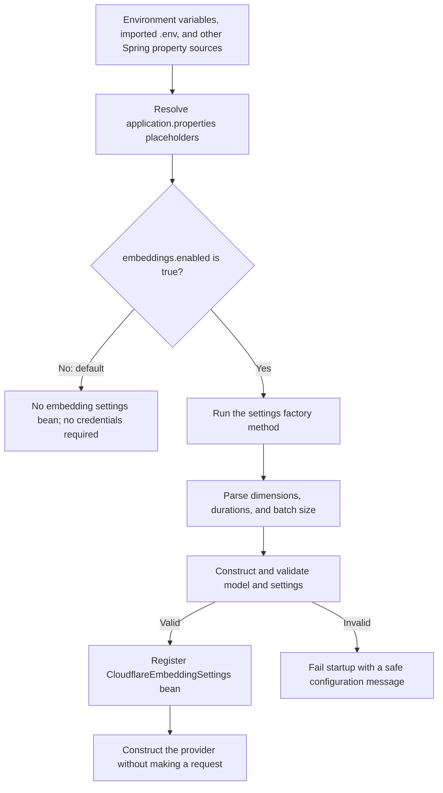
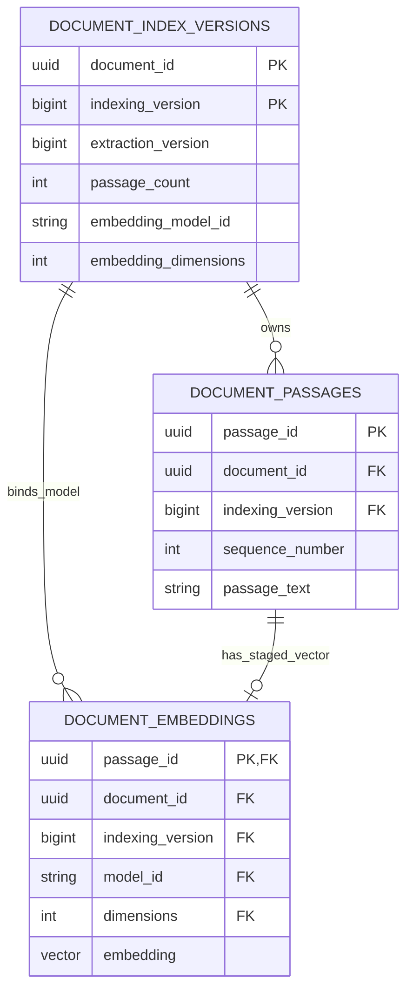
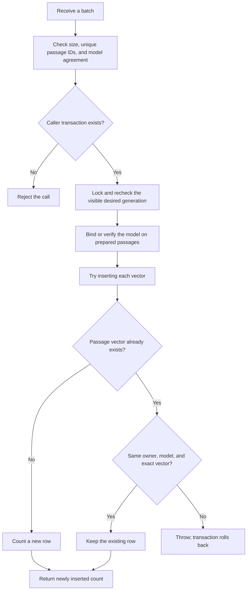
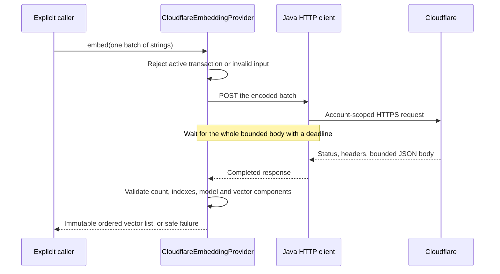
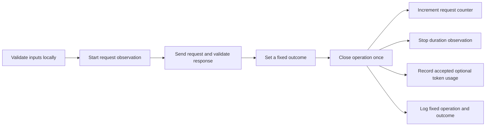

# Understanding embeddings: contracts, storage, and HTTP

This guide explains how the current embedding code works: its Java types, Spring configuration, PostgreSQL storage, and Cloudflare HTTP adapter. Read it alongside the linked source files.

The model rules, storage adapter, and HTTP adapter are joined by a durable document embedding handler. **Background embeddings are disabled by default. When explicitly enabled, prepared passages are sent to Cloudflare and their vectors are staged locally.** Index activation, semantic search, and chat are absent from the current code.

The diagrams use Mermaid. Open this file in a Markdown viewer with Mermaid support to render them. The tables and text examples explain the same ideas if your viewer displays the diagram source.

## 1. Where embeddings fit in the product

An embedding is a list of numbers produced from text by a trained model. It lets us compare text numerically to find passages with similar meaning. This is different from asking a chat model to write an answer.

Imagine your notes contain:

> Plants convert sunlight into chemical energy.

You search for:

> How do plants get energy from light?

The wording differs. Embedding both texts with the same model can put them near each other in its numerical representation. This is useful evidence for retrieval, but it does not establish that a passage answers every part of a question or that a generated answer is true.

### Current data flow



The handler is opt-in through `secondbrain.embeddings.enabled`. Startup constructs the client without a test request; background workers may then process new and retained document facts. Enabling with polling active permits real passage text to leave the computer. Keeping the default disabled requires no Cloudflare credentials and makes no inference calls.

For semantic search, passage embeddings represent stored text and a query embedding represents the search text. Comparing those vectors would identify related passages. Writing a cited answer would require a separate chat operation. Search, index activation, and chat are absent from the current implementation.

## 2. What “1024 dimensions” means

Our supported model contract is:

```text
model ID:    @cf/baai/bge-m3
dimensions:  1024
```

“1024 dimensions” means **one text input produces a vector containing 1024 numbers**. It does not mean 1024 words, passages, tokens, or requests.

Here is an invented three-number example to make the shape readable:

| Input | Toy vector |
|---|---|
| A passage about plants using sunlight | `[0.90, 0.30, 0.10]` |
| A question about plants getting energy from light | `[0.88, 0.31, 0.12]` |
| A passage about replacing a bicycle tire | `[0.10, 0.05, 0.95]` |

These numbers are illustrative, not real model outputs or measured retrieval results. The individual positions are learned coordinates; we cannot simply label one position “plants” and another “bicycles.”

In the application, each row would contain 1024 components. Similarity search will compare the direction of vectors using cosine similarity.

**Matching the number of components is necessary but insufficient.** Two different models may both produce 1024 numbers while using different coordinate systems. Indexing and query embedding must use the same compatible model configuration. Changing that configuration requires deliberate reindexing of the stored passages.

## 3. The source files and their separate jobs

Paths below are relative to `src/main/java/dev/secondbrain/`.

| File | Question it answers | Responsibility |
|---|---|---|
| [EmbeddingModel.java](../src/main/java/dev/secondbrain/embeddings/EmbeddingModel.java) | Which numerical representation do we accept? | Validate the supported model ID/dimension pair |
| [EmbeddingVector.java](../src/main/java/dev/secondbrain/embeddings/EmbeddingVector.java) | Is this returned vector safe to use? | Validate and protect numerical components |
| [EmbeddingProvider.java](../src/main/java/dev/secondbrain/embeddings/EmbeddingProvider.java) | What must an embedding service be able to do? | Define the shared Java interface |
| [CloudflareEmbeddingSettings.java](../src/main/java/dev/secondbrain/embeddings/CloudflareEmbeddingSettings.java) | Which account, destination, and limits are configured? | Hold validated settings and protect credentials in diagnostics |
| [EmbeddingConfiguration.java](../src/main/java/dev/secondbrain/config/EmbeddingConfiguration.java) | When and how does Spring create those settings? | Read external values and construct settings and provider beans |



The Cloudflare adapter receives those settings when explicitly enabled. Constructing it makes no request; a caller must invoke embed.

This separation lets document indexing and future search use the same embedding interface without putting HTTP code inside document repositories or controllers.

## 4. `EmbeddingModel`: a small Java record with rules

The declaration is:

```java
public record EmbeddingModel(String id, int dimensions) {
    // Constants and validation follow in the actual file.
}
```

A record is a concise way to represent a value. Java generates its accessors, equality, hash code, and a textual representation. Its fields cannot be reassigned after construction.

For example:

```java
var model = new EmbeddingModel("@cf/baai/bge-m3", 1024);
String name = model.id();
int count = model.dimensions();
```

`var` means Java infers the local variable's type from the expression on the right. `model` still has the fixed type `EmbeddingModel`; Java has not made it dynamically typed.

The compact constructor in the real file runs whenever someone calls `new EmbeddingModel(...)`. It rejects anything except the explicitly supported pair. An unsupported value throws `IllegalArgumentException`, so an invalid model object cannot escape the constructor.

The constants use `public static final`:

- `public`: other packages can access them.
- `static`: they belong to the class, so no object is needed to read them.
- `final`: the constant reference/value cannot be reassigned.

Defining this pair does not download a model or contact Cloudflare. It defines our compatibility rules. BGE-M3 is the initial supported candidate; live compatibility and retrieval quality remain unverified.

## 5. `EmbeddingVector`: protect the result at the boundary

A provider response becomes an `EmbeddingVector` only if it satisfies these rules:

| Check | Why it matters |
|---|---|
| The model and component array exist | Required data must not be missing |
| Component count matches the model | A 768-number result cannot enter a 1024-dimensional index |
| Every component is finite | `NaN` and positive/negative infinity cannot be treated as ordinary coordinates |
| At least one component is nonzero | A zero vector has no direction for cosine similarity |

The constructor stores a copy of the input array. The accessor also returns a copy.

```text
Caller's input array --clone--> private stored array --clone--> caller's returned array
```

Why are two copies important? In Java, `final float[] values` prevents replacing the array reference, but it does not prevent changing `values[0]`.

Without copying, a caller could supply a valid array, then change a component to `NaN` after validation. Or a caller could modify the array returned by `values()` and silently change the object's internal state.

The test demonstrates that both paths are protected:

```java
var components = new float[1024];
components[0] = 0.125f;
var vector = new EmbeddingVector(model, components);

components[0] = Float.NaN;
var returned = vector.values();
returned[0] = Float.POSITIVE_INFINITY;

// The vector's internal first component is still 0.125f.
```

The `f` suffix makes a numeric literal a Java `float`. Without it, a decimal literal such as `0.125` is a `double`.

`toString()` deliberately returns only something like `EmbeddingVector[dimensions=1024]`. It does not expose the coordinates. Even a protected textual representation is not a reason to log entire objects by default.

## 6. `EmbeddingProvider`: an interface is a promise

The interface declares:

```java
EmbeddingModel model();
List<EmbeddingVector> embed(List<String> inputs) throws InterruptedException;
```

Read that as:

1. A provider can tell us which model it uses.
2. It can receive a list of texts and return a list of vectors.
3. The vectors must correspond to the texts in the same order.
4. Its work can be interrupted, for example during shutdown.

`List<String>` means a list whose elements are strings. `List<EmbeddingVector>` means a list whose elements are vectors. These are Java generics: the compiler checks the element types.

The interface has no implementation body. `CloudflareEmbeddingProvider` uses `implements EmbeddingProvider` and supplies the HTTP behavior. **Declaring the interface does not execute a request or register a Spring bean.**

In NestJS terms, this resembles an application-facing TypeScript interface plus the idea of a provider implementation. One difference is that Java interfaces exist as runtime types; Spring can inject a registered implementation by its Java interface type. The opt-in configuration registers that implementation as a bean. Merely having an interface on the classpath would not register it.

The interface separates responsibilities; it does not introduce multiple external providers. The selected external service remains Cloudflare.

## 7. How configuration reaches the Java objects

Spring already imports `.env` as a properties file through:

```properties
spring.config.import=optional:file:.env[.properties]
```

The application properties include:

```properties
secondbrain.embeddings.enabled=${SECONDBRAIN_EMBEDDINGS_ENABLED:false}
secondbrain.embeddings.model=${CLOUDFLARE_EMBEDDING_MODEL:}
secondbrain.embeddings.dimensions=${CLOUDFLARE_EMBEDDING_DIMENSIONS:0}
```

For `${NAME:fallback}`, Spring looks up `NAME` in its configuration sources and uses the fallback if it is absent. An empty fallback after `:` means an empty string.

The import makes the uppercase names available even when they are entries in our `.env` properties file rather than exported shell variables. An ordinary `.env` file is not automatically imported by every Java application; our explicit Spring setting enables this behavior.



Malformed numeric/duration input can fail during parsing, before an object constructor runs. This also prevents startup from accepting that configuration.

### The Spring annotations in this file

| Annotation | Meaning here | Approximate NestJS comparison |
|---|---|---|
| `@Configuration` | This class declares Spring-managed object factories | A module's provider configuration |
| `@Bean` | Register the returned object in Spring's application context | A `useFactory` provider |
| `@ConditionalOnProperty` | Load this configuration only when the property has the required value | Conditional/dynamic module configuration |
| `@ConditionalOnMissingBean` | Use the default adapter only when no other provider bean is supplied | An explicitly overridable provider registration |

The main application scans its packages during startup. That is how it discovers `config.EmbeddingConfiguration`; we do not call it from a controller.

Spring supplies `Environment` to the factory method. This is dependency injection: Spring provides an existing dependency rather than requiring the method to construct one. `Environment` gives access to resolved application configuration.

The factory explicitly calls `new EmbeddingModel(...)` and `new CloudflareEmbeddingSettings(...)`. **Only the returned settings object is registered by this `@Bean` method.** Constructing the nested model object does not automatically register a separate model bean. A second `@Bean` method receives the settings and a Clock, constructs the provider, and arranges for its close method to run during application shutdown.

`proxyBeanMethods = false` tells Spring not to create proxies for direct calls between bean factory methods. This configuration does not need that interception.

## 8. Settings, defaults, and limits

| Value | Default | Validation when enabled |
|---|---|---|
| Enabled flag | `false` | Only explicit `true` loads this configuration |
| Cloudflare account ID | Empty | Exactly 32 hexadecimal characters |
| API token | Empty | 1–4096 printable ASCII characters, without spaces/control characters |
| Model | Empty | Exactly `@cf/baai/bge-m3` |
| Dimensions | `0` | Exactly `1024` |
| Connect timeout | `2s` | At least 100 ms, at most 10 seconds |
| Request timeout | `30s` | At least the connect timeout, at most 60 seconds |
| Batch size | `8` | Between 1 and 32 inputs |

The account ID and token identify/authenticate the account; they are unrelated to document IDs and correlation IDs.

Account/token checks validate their format only. They do not verify that the account exists, the token works, permissions are sufficient, or the account uses the free plan.

The default model/dimension values are intentionally invalid for an enabled configuration. Enabling it requires an explicit model choice. Leaving the feature disabled needs no credentials or model choice.

Connect timeout bounds connection establishment, request timeout bounds the request operation, and batching limits how many texts enter one request. **The HTTP adapter enforces these settings when embed is explicitly called. Validating settings or constructing the adapter makes no inference request.** A batch of eight texts means eight vectors, not one average vector and not necessarily eight network requests.

The endpoint method constructs one account-scoped HTTPS destination on `api.cloudflare.com`. It does not send anything. Credentials are excluded from `toString()` and validation errors. The tests check both logs and exception text for synthetic secret sentinels.

## 9. How this connects to our durable events

Passage processing stores the passages and `PassagesPrepared` fact atomically with its delivery acknowledgment. [DocumentEmbeddingHandler](../src/main/java/dev/secondbrain/documents/DocumentEmbeddingHandler.java) consumes that fact when enabled. The event's processing version identifies the index generation, which separately records its source extraction version.

The handler reads one bounded batch of **missing** vectors, closes its read transaction, asks the provider for those passage texts, and associates the ordered results with stable passage IDs. It then asks the dispatcher to save a checkpoint. This is a short write transaction; the next HTTP call begins only after it ends.

```mermaid
sequenceDiagram
    participant H as DocumentEmbeddingHandler
    participant D as Dispatcher checkpoint
    participant DB as PostgreSQL
    participant C as Cloudflare
    H->>DB: Read missing batch; end read transaction
    H->>C: embed(texts)
    C-->>H: Validated ordered vectors
    H->>D: save(batch effect)
    D->>DB: Begin; lock and validate delivery lease
    D->>DB: Lock and recheck desired document/source generation
    D->>DB: Insert immutable vectors
    D->>DB: Recheck unexpired lease; finish write transaction
    D-->>H: Saved outcome, or empty if lease was lost
    Note over H,DB: Delivery stays RUNNING; attempt and deadline are unchanged
```

The checkpoint is supplied by the dispatcher as an [EventHandler.Checkpoint](../src/main/java/dev/secondbrain/events/EventHandler.java). In Java, a nested functional interface describes a value with one operation; here a lambda binds `save` to this specific delivery lease. Existing handlers use the default two-argument `prepare` method, which delegates to their ordinary `prepare(event)`. The embedding handler overrides the two-argument method because its preparation saves bounded progress.

`save` returns `Optional<Outcome>`. Empty means ownership was lost; the handler stops. `SKIPPED` means the document or generation became ineligible; it also stops. A saved `COMPLETED` outcome describes **that batch**, not the whole delivery. The delivery remains running until the final completeness check and acknowledgment succeed together.

If ownership expires during a checkpoint, its writes roll back. Earlier successful checkpoints remain stored. On a retry or restart, the missing-batch query excludes those saved passages, so only unfinished work needs provider calls. The existing attempt limit and overall execution deadline still apply; saving progress does not reset either one.

When no vectors are missing, the final effect locks/rechecks document eligibility and verifies the expected passage/vector count and model. The dispatcher then acknowledges the delivery in the same transaction. This does **not** activate a searchable index. If acknowledgment fails, the staged vectors remain; a retry can check completeness without repeating completed HTTP work.

A crash between a provider response and its checkpoint can require repeating the request. Idempotent database writes prevent duplicate stored results; they cannot guarantee exactly-once external processing or allowance consumption.

## 10. Current capabilities and boundaries

| Capability | Current state |
|---|---|
| Explicit model/dimension compatibility rules | Implemented |
| Validated vectors with defensive copies | Implemented |
| Shared provider interface | Implemented with an opt-in Cloudflare adapter |
| Opt-in configuration and safe validation | Implemented |
| HTTP calls and provider response validation | Implemented with bounded inputs, responses, and deadlines |
| Vector storage in PostgreSQL/pgvector | Implemented with resumable bounded checkpoints |
| Durable embedding consumer and batch recovery | Implemented; disabled by default |
| Safe provider request metrics, logs, and child traces | Implemented; export optional |
| Complete-index activation and semantic search | Not implemented |
| Live model/account/quality/free-allowance verification | Not performed |

The model, data, and configuration rules give callers a consistent contract. That contract alone cannot establish live inference compatibility or retrieval quality.

The HTTP adapter uses Java's built-in HTTP client and the existing Jackson JSON library. We have not added Spring AI or a paid OpenAI account. Cloudflare's “OpenAI-compatible” endpoint describes a request/response protocol; Cloudflare is still the service receiving the request.

Our free-only requirement also depends on staying on the correct Cloudflare account plan. Java configuration cannot guarantee an account's billing settings. The provider allowance is finite. Retryable failures delay the existing delivery without holding its worker, and the configured attempt limit remains enforced.

## 11. Understanding and checking the model and configuration

Read the five production files in the order listed in section 3. Then open:

- [EmbeddingVectorTest.java](../src/test/java/dev/secondbrain/embeddings/EmbeddingVectorTest.java) for mutation protection, invalid dimensions, nonfinite components, and zero vectors.
- [EmbeddingConfigurationTest.java](../src/test/java/dev/secondbrain/config/EmbeddingConfigurationTest.java) for Spring startup, opt-in behavior, external-property mapping, and safe invalid-configuration failures.

From the repository root:

```sh
./mvnw -Dtest=EmbeddingConfigurationTest,EmbeddingVectorTest test
```

These configuration/vector checks use synthetic values and make no network request. An enabled configuration constructs an idle client, which closes with the test context. No real account or Docker is required. They check the model and configuration independently. The full project completion check remains:

```sh
./mvnw verify
```

That also requires access to Docker and a local HTTP listener for the existing integration tests. A successful focused run does not replace those checks. You do not need to fill in real Cloudflare credentials to study or test this code. Keep embeddings disabled during ordinary startup.

Questions to answer after reading:

1. Why does changing the model require more than changing `1024` to another number?
2. Why does a `final` array still need defensive copies?
3. Why does an interface alone never call the provider?
4. Which exact object does the `@Bean` method register?
5. Why can configuration validation pass even if an API token has expired?
6. Why could a retry consume allowance twice while storing only one logical result?

## 12. How vector storage is organized

The repository stores supplied vectors in PostgreSQL. The document handler supplies results from the HTTP provider to the storage adapter through delivery checkpoints.

### Storage classes and migration

| File | Responsibility |
|---|---|
| [V11 migration](../src/main/resources/db/migration/V11__persist_versioned_passage_embeddings.sql) | Add vector storage and enforce database relationships |
| [PassageEmbedding.java](../src/main/java/dev/secondbrain/documents/PassageEmbedding.java) | Associate one immutable vector with one stable passage UUID |
| [JdbcEmbeddingRepository.java](../src/main/java/dev/secondbrain/documents/JdbcEmbeddingRepository.java) | Store a bounded batch under document/version and transaction guards |
| [EmbeddingRepositoryIT.java](../src/test/java/dev/secondbrain/documents/EmbeddingRepositoryIT.java) | Exercise actual PostgreSQL constraints, rollback, retries, and concurrency |

The storage classes live in `documents` because passages, index generations, and deletion belong to that feature. The shared numerical model and provider interface stay in `embeddings`. Storage neither calls the provider nor knows its account/token.

`DocumentConfiguration` registers the repository bean. Its constructor receives `JdbcClient`, `JdbcIndexingRepository`, and the transaction manager. All refer to the same application datasource. Constructing this bean performs no SQL or network request. It needs no Cloudflare credentials.

### Three tables, three responsibilities



The diagram omits some existing passage/source fields for readability. `vector` here means the actual PostgreSQL column type `vector(1024)`.

- `document_index_versions` identifies a particular rebuild of a document and the extracted-text version it uses. It also records the model/dimensions selected by its first stored batch.
- `document_passages` holds the text and source location for each stable passage ID.
- `document_embeddings` holds at most one vector for each passage ID. It repeats document/index/model identifiers so the database can check their relationship directly.

This repeated metadata is intentional. A valid passage UUID alone must not let code attach the vector to a different document or generation.

A **primary key** prevents duplicate identities. A **foreign key** checks that a referenced owner exists. A **composite foreign key** checks multiple columns together: the passage, document, and index generation must belong to the same row, and the stored model/dimension pair must match the index's binding.

The paired model fields start as `NULL`, meaning “not bound yet.” Both must be absent or both present. Binding a model also requires prepared-passage metadata. `NULL` does not mean failure, success, or a second job status; event deliveries remain our job records.

### What pgvector adds

PostgreSQL stores ordinary relational data already. The pgvector extension adds a numerical vector type and distance operations inside the same database. We do not introduce another database or vector service.

Conceptually, a row contains:

```text
passage_id:       the stable UUID of this passage
indexing_version: 7
model_id:         @cf/baai/bge-m3
dimensions:       1024
embedding:        [number, number, ... 1024 components ...]
```

The `vector(1024)` column enforces the actual number of components. The extension rejects nonfinite values, and our SQL constraint also rejects zero vectors. See the [pinned pgvector reference](https://github.com/pgvector/pgvector/blob/v0.8.7/README.md#vector-type). These database checks complement the earlier Java constructor checks; they also protect the table from invalid direct SQL.

There is a normal index on `(document_id, indexing_version)` for accessing a generation's rows. There is no approximate-nearest-neighbor search index yet, and no search endpoint. The term “indexing version” is our application generation number; it is different from a database index that accelerates queries.

### Why V11 instead of changing V10?

Flyway applies versioned migrations in order and records their checksums. Existing databases may already have V10. Editing an applied migration could make those databases fail validation and would not supply a clean upgrade path.

V11 defines the embedding fields, table, and constraints. Existing documents and passages stay in place; existing generations start with no model binding and no embeddings. This migration does not generate vectors or backfill them through a remote service.

## 13. How one batch is stored

The repository method is:

```java
int insertBatch(IndexingVersion version,
                EmbeddingModel model,
                List<PassageEmbedding> batch)
```

It returns the number of **new rows inserted**, not the total vectors for that document and not a success/failure flag. Zero can mean every supplied vector was already stored identically.



The diagram condenses the loop. Every row in the batch is checked before the method returns. Any invalid ownership or SQL constraint failure also aborts the batch.

### Step A: validate the batch

The method accepts 1–32 items, rejects repeated passage IDs within one call, and requires each vector's model to match the supplied model. The immutable `EmbeddingVector` has already checked its numbers.

Thirty-two is the repository's fixed upper bound. The configurable default batch size of eight controls the HTTP adapter; a document worker must respect it when integration is present. One is the storage ceiling; the other is a chosen request size.

### Step B: join the caller's transaction

`PROPAGATION_MANDATORY` means an existing transaction is required. The adapter cannot quietly finalize its own independent transaction.

For example, if the caller performs:

```text
BEGIN
    store vectors
    perform another required stage write
    something fails
ROLLBACK
```

The vector rows and any newly established model binding roll back too. The dispatcher uses this property to fence checkpoint writes and final acknowledgment by delivery ownership. The repository itself has no knowledge of lease tokens.

Our adapter uses separate parameterized statements for the rows, grouped in one transaction. Each statement has a five-second query timeout; the caller still owns the overall transaction timeout. It does not send a single bulk SQL statement and does not finalize each vector separately. This is bounded by at most 32 vectors per call.

### Step C: prevent stale writes

Before inserting, the adapter locks the document and checks that the requested index is still desired, its source extraction still matches, and the document is still visible/extracted. Starting a newer index, changing the source, marking deletion, or removing the document makes old work ineligible.

That lock coordinates current database state. The dispatcher additionally checks its delivery lease before and after the checkpoint effect. Both fences are required: a document-version check does not establish lease ownership by itself.

### Step D: bind the model

The first successful batch records the model and dimensions on its index generation. Later batches must agree. The model binding and the batch rows are saved atomically; a failed first batch leaves neither behind.

The current Java and SQL contracts support only the explicit BGE-M3/1024 pair. Supporting another pair would require deliberate code/schema changes and a new index generation, not editing a model string on an existing populated generation.

### Step E: handle retries without overwriting

The insert uses:

```sql
ON CONFLICT (passage_id) DO NOTHING
```

That alone would be insufficient: it could silently ignore a conflicting result. When an existing row is encountered, the adapter checks its owner/model and numerical equality.

| Attempt | Result |
|---|---|
| New passage ID with valid ownership | Insert it |
| Same passage ID and identical vector/model/owner | Keep the original; count zero new rows for it |
| Same passage ID with different values | Reject; roll back this call |
| Passage belongs to another document/version | Reject; roll back this call |

Example: suppose the first batch contains passages 1–8 and its transaction succeeds. A retry supplies the same eight results. It inserts zero new rows. A later batch for passages 9–16 can still make progress. The adapter preserves previously persisted batches, while an error inside the current batch rolls that whole batch back.

If a conflicting item appears after a new item in the same call, that earlier new insert also rolls back. Existing persisted rows remain unchanged. Rejecting conflicting results avoids silently mixing numerical snapshots within one generation.

### Step F: let PostgreSQL own the vector representation

The adapter serializes validated floats into a bracketed literal and binds that value as a SQL parameter. The SQL uses `CAST(:embedding AS vector)`; numerical content is not concatenated into executable SQL.

`Float.toString` gives a locale-independent representation, including scientific notation. Database tests read the stored result back as a PostgreSQL `real[]` and compare every component, so the check is independent of simply regenerating the same input literal.

The adapter does not log vector values or provider data. Its repository method does not contact Cloudflare.

### How deletion affects vectors

`ON DELETE CASCADE` follows ownership. Physically removing a passage or its index/document removes dependent vector rows as part of the database operation. An immediate deletion marker still serves a different purpose: it excludes a document before asynchronous physical cleanup finishes.

Stored vectors from old generations are staging/history data, not automatically visible search results. Later retrieval must use the active, complete generation of a visible document.

## 14. Checking storage behavior

Run the isolated database checks with Docker available:

```sh
./mvnw -Dit.test=EmbeddingRepositoryIT,DatabaseMigrationIT verify
```

The storage suite covers multi-batch continuation through fresh JDBC collaborators, exact component round-trip, identical/conflicting retries, rollback and injected SQL failure, concurrent writers, version/document separation, cascade cleanup, stale/deleted work, batch bounds, and direct database constraints. The tests use generated vectors and an isolated PostgreSQL/pgvector Testcontainer. They require no Cloudflare account or real document uploads.

These are integration tests because locking, foreign keys, the pgvector type, and transaction rollback need real PostgreSQL behavior. Fast tests alone cannot establish those properties. The existing complete gate remains `./mvnw verify`.

Verification results belong in the implementation plan, separately from this learning guide.

For a read-only look at staging in your normal database after applying V11:

```sql
SELECT i.document_id, i.indexing_version, i.passage_count,
       i.embedding_model_id, i.embedding_dimensions,
       count(e.passage_id) AS stored_vectors
FROM document_index_versions i
LEFT JOIN document_embeddings e
    ON e.document_id = i.document_id
    AND e.indexing_version = i.indexing_version
GROUP BY i.document_id, i.indexing_version, i.passage_count,
         i.embedding_model_id, i.embedding_dimensions
ORDER BY i.document_id, i.indexing_version;
```

With embeddings disabled, ordinary uploads have zero stored vectors and empty model fields. With the handler enabled, vectors appear as batches finish; incomplete generations remain staging data. Storage tests populate isolated containers, not your normal library database.

## 15. How the HTTP adapter works

The Cloudflare implementation of `EmbeddingProvider` sends a bounded batch when called. The opt-in document handler invokes it outside transactions; disabled embeddings leave uploads at prepared passages.

| File | Job |
|---|---|
| [CloudflareEmbeddingProvider.java](../src/main/java/dev/secondbrain/embeddings/CloudflareEmbeddingProvider.java) | Validate inputs, send HTTP, bound waiting/body size, cancel, and close resources |
| [CloudflareEmbeddingProtocol.java](../src/main/java/dev/secondbrain/embeddings/CloudflareEmbeddingProtocol.java) | Encode/decode bounded JSON and translate HTTP/provider errors |
| [EmbeddingFailure.java](../src/main/java/dev/secondbrain/embeddings/EmbeddingFailure.java) | Expose a fixed error reason, retryable flag, and optional retry timestamp safely |

These are separate from the SQL repository. The HTTP adapter cannot insert vectors or complete an event delivery. The repository cannot make an HTTP request. The document handler coordinates them through the dispatcher's checkpoint boundary.

### What one call does



The production destination is fixed to the Cloudflare HTTPS endpoint derived from the account ID. A package-private constructor allows a literal loopback address for tests. This is not an application setting for arbitrary hosts. Redirect following is disabled, so a redirect response cannot silently send the next request and its credentials somewhere else.

### One batch is one application attempt

With the default batch size of eight, calling `embed` with eight texts produces one application request that asks for eight vectors. Calling it with nine texts is rejected; this adapter does not silently split a larger collection into more requests.

The document handler owns batching across a document. Durable delivery owns retries. There is no sleep/retry loop inside this adapter and no second provider/model fallback. Ordinary TCP connection handling is not an exactly-once remote-execution guarantee: an interrupted or crashed process may still be unsure whether the remote service processed a request.

The request body has this shape:

```json
{
  "model": "@cf/baai/bge-m3",
  "input": ["A synthetic first passage", "A synthetic second passage"],
  "encoding_format": "float"
}
```

The token travels in the Authorization header, not inside this JSON body. Those passages really would leave the computer if an enabled provider is explicitly called with them. Synthetic tests do not establish live account permissions or model compatibility.

### Why a future is used even though embed waits

`sendAsync` returns a `CompletableFuture`: a handle for a result that will become available later. Our caller then waits on that future with a timeout. The HTTP request also has its configured timeout.

Crucially, the response handler collects a bounded byte array. The future completes after the body has been received, not merely when response headers arrive. A server cannot evade this waiting deadline by sending headers and then holding the body open. A timeout cancels the pending operation.

This does not turn document processing into an unbounded background job system. The caller still waits on its configured worker; Java's HTTP client uses a separate bounded executor for networking tasks (two threads and a 64-task queue). Two networking threads do not mean exactly two requests can be in flight: the durable worker's separate concurrency limits still matter.

`AutoCloseable` gives the adapter a close method. Spring registers it as the bean's shutdown method. It cancels owned HTTP activity and shuts down the networking executor. Tests close adapters with try-with-resources as well.

### Input and response limits

| Boundary | Rule | Reason |
|---|---|---|
| Inputs | 1 through the configured batch size; at most 32 | Bound each operation |
| Each text | Nonblank, valid Unicode, no NUL, at most 1200 code points | Match the bounded passage contract and reject malformed data |
| Encoded request | At most 256 KiB | Bound JSON bytes as well as character count |
| Response stream | At most 1 MiB | A remote service must not make us buffer an unlimited body |
| JSON | Bounded depth, names, strings, number length, and tokens | Bound parsing even for unexpected content |
| Result | Exactly one valid 1024-component vector per input | Prevent partial, duplicate, or mismatched output |

The parser also rejects duplicate JSON fields and extra JSON values after the first document. These limits are application policy, not a measurement of Cloudflare's maximum supported context.

Response entries carry input indexes. If a response presents index 1 before index 0, the adapter reconstructs the original input order. A repeated, missing, fractional, or out-of-range index fails validation. An optional returned model field must match our request; its absence does not prove or disprove a hosted model revision. Live compatibility/quality remains unverified.

### Java interruption is a cancellation signal

During shutdown, a caller may interrupt a thread that is waiting on HTTP. The adapter cancels its pending future, restores the thread's interruption flag, and throws `InterruptedException` to the caller. It does not quietly turn shutdown into a successful embedding.

The adapter also refuses to start inside an active database transaction. The document handler reads a batch, ends its read transaction, calls the provider, then requests a short fenced write checkpoint. Waiting for a network service while holding document locks would unnecessarily block deletion/reindexing.

### Errors become a small, safe vocabulary

| Reason | Retryable classification | Interpretation |
|---|---|---|
| `ACCESS_DENIED` | No | Authentication/account permission problem |
| `MODEL_UNAVAILABLE` | No | Missing/inaccessible model or paid-only requirement |
| `INVALID_INPUT` | No | Our request/input is unacceptable |
| `INVALID_RESPONSE` | No | The returned data does not satisfy our contract |
| `RATE_LIMITED` | Yes | Temporary rate/capacity restriction |
| `QUOTA_EXHAUSTED` | Yes | Documented daily free allowance exhaustion |
| `UNAVAILABLE` | Yes | Provider/transport failure, including an incomplete or oversized stream |
| `TIMED_OUT` | Yes | The operation did not finish within its deadline |

“Retryable” does not mean “repeat immediately or forever.” The adapter classifies the failure and returns a safe hint. The document handler translates that classification into a delivery failure. The dispatcher releases the attempt and persists retry eligibility using the later of normal backoff and the provider hint. Already saved vectors remain staged. Exhausted attempts stay failed even after the hinted time passes.

Cloudflare documents quota code `3036`. We recognize that numeric code in a 429 response and suggest the next UTC daily reset. We do not search human-readable error messages for words such as “quota.” Valid `Retry-After` seconds or HTTP dates become optional timestamps; a quota hint never precedes its suggested reset. The adapter never waits until that timestamp.

A paid-only-model error is a permanent model failure. It does not trigger a plan upgrade or fallback call. The program still cannot inspect or enforce the account's billing plan; using Workers Free remains a setup prerequisite.

### Why exception causes need care

An HTTP or JSON exception may contain a URL, response excerpt, or other private data. Simply wrapping it as the standard cause of a new exception would let a normal printed stack trace expose it.

`EmbeddingFailure` therefore exposes a fixed reason and safe message. Its original diagnostic cause is held privately in a transient field, outside the normal `getCause()` chain and ordinary Java serialization. Its retry timestamp contains no provider message. This is a deliberate privacy boundary, not a general recommendation to erase all exception causes throughout Java code.

The tests print failure stack traces and capture output with synthetic private markers to check this behavior. We do not enable HTTP body/header logging or provider prompt capture.

## 16. What the HTTP tests establish

[CloudflareEmbeddingProviderTest](../src/test/java/dev/secondbrain/embeddings/CloudflareEmbeddingProviderTest.java) exercises protocol rules and guards without a listener or live account. [EmbeddingConfigurationTest](../src/test/java/dev/secondbrain/config/EmbeddingConfigurationTest.java) also proves opt-in provider construction and replacement by a controlled fake without credentials.

[CloudflareEmbeddingHttpIT](../src/test/java/dev/secondbrain/embeddings/CloudflareEmbeddingHttpIT.java) uses an actual server on `127.0.0.1` with synthetic account/token/text. It checks real request serialization and ordering, status/quota errors without automatic retries, redirects, the Unicode batch boundary, oversized streams, connection failure, slow headers and body, and cancellation during a request.

```sh
./mvnw -Dtest=CloudflareEmbeddingProviderTest,EmbeddingConfigurationTest,EmbeddingVectorTest test
./mvnw -Dit.test=CloudflareEmbeddingHttpIT verify
```

The first command needs neither Docker nor a socket listener. The second needs local socket permission but no Docker or Cloudflare account. The full project gate remains `./mvnw verify`.

An HTTP stub proves how our client handles controlled responses. It does not prove that a real token works, that Cloudflare's hosted output matches the fixture, that account usage is free, or that retrieval quality is good. A separately invoked bounded live smoke check is still pending. The document handler and PostgreSQL delivery tests cover orchestration separately from the HTTP protocol.

## 17. Checking durable batching and recovery

[DocumentEmbeddingHandlerTest](../src/test/java/dev/secondbrain/documents/DocumentEmbeddingHandlerTest.java) uses controlled collaborators to check batch ordering, transaction boundaries, missing-result handling, interruption, stale documents, and final completeness. [DocumentEmbeddingConfigurationTest](../src/test/java/dev/secondbrain/documents/DocumentEmbeddingConfigurationTest.java) checks the opt-in boundary without real credentials.

[DocumentEmbeddingDeliveryIT](../src/test/java/dev/secondbrain/events/DocumentEmbeddingDeliveryIT.java) runs the real application/dispatcher against isolated PostgreSQL with a deterministic provider. It exercises multi-batch completion, partial progress across restart, response-after-expiry recovery, source/reindex/deletion changes during inference, acknowledgment rollback, and retained-event scheduling. [DurableEventsIT](../src/test/java/dev/secondbrain/events/DurableEventsIT.java) additionally checks checkpoint rollback, stale tokens, persisted retry hints, and attempt exhaustion.

```sh
./mvnw -Dtest=DocumentEmbeddingHandlerTest,DocumentEmbeddingConfigurationTest test
./mvnw -Dit.test=DocumentEmbeddingDeliveryIT,DurableEventsIT,EmbeddingRepositoryIT verify
```

The second command requires Docker. Both use synthetic data and no live inference. The overall gate is `./mvnw verify`. Test definitions describe what should be checked; current run results are recorded in the implementation plan.

## 18. Understanding embedding telemetry

Telemetry is information about an operation, such as its duration and outcome. It is separate from the operation's saved business data. [EmbeddingTelemetry](../src/main/java/dev/secondbrain/embeddings/EmbeddingTelemetry.java) observes the Cloudflare adapter; it never receives passage text, an HTTP request, an API token, a vector, or an exception.



Only calls reaching the transport boundary count. If the adapter rejects an empty batch before sending, no provider attempt is recorded. If the provider itself rejects a request, its safe outcome is counted. `success` means valid vectors were returned, not that PostgreSQL has saved them or search is ready.

The implementation uses the existing Micrometer registries:

- A **counter** adds up events. `secondbrain.embedding.requests` separates fixed outcomes such as `success`, `quota_exhausted`, and `timed_out`.
- An **observation** describes one operation. The standard meter handler turns its `secondbrain.embedding.request.duration` name into a duration timer; the tracing handler creates an `embedding.request` child span.
- A **label** groups measurements. Outcome values come from a closed Java enum, keeping the number of time series bounded. Document IDs, text, URLs, and arbitrary error messages are not labels.

The observation inherits the current delivery/request trace without opening a replacement scope. The durable event context therefore remains the parent while the HTTP operation has its own span. The trace exporter allows only known operation names and outcomes, and removes private attributes and exception events.

The operation object implements `AutoCloseable`, so try-with-resources records completion even when the HTTP call throws. Its state belongs to that one call, not to the shared singleton telemetry service. Closing twice does not count twice. Telemetry failures are caught at their own boundary; a broken metrics backend cannot turn a valid embedding into a failed delivery or replace the original provider failure.

### Token reports are optional

A successful response may include `usage.prompt_tokens`. The bounded parser accepts a nonnegative integer no larger than 1,000,000. That ceiling is a sanity limit, not a claim about model capacity. Missing, fractional, negative, oversized, or textual values are ignored while valid vectors remain usable.

`secondbrain.embedding.tokens` totals accepted input-token reports; `secondbrain.embedding.usage.reports` counts how many successful responses supplied them. A legitimate report of zero adds zero tokens but one report. No report adds neither. Neither counter estimates remaining daily allowance, records billing, or survives process restart. Failed responses and crashes may consume provider allowance without appearing in these successful-response token totals.

[EmbeddingTelemetryTest](../src/test/java/dev/secondbrain/embeddings/EmbeddingTelemetryTest.java) uses a controllable meter clock and an in-memory tracer to check timing, outcomes, trace parentage, and fault isolation. [EmbeddingTelemetryEndpointTest](../src/test/java/dev/secondbrain/embeddings/EmbeddingTelemetryEndpointTest.java) verifies the actual Actuator response with MockMvc. The loopback HTTP tests cover telemetry through the actual client with synthetic text and credentials.

See [embedding request telemetry](../docs/development.md#embedding-request-telemetry) for metric queries and the separate live smoke-check instructions. Synthetic tests do not establish real account permissions, model quality, or remaining free allowance.

## References and related notes

The source files are the authority for current behavior. [The local architecture](../.task/architecture.md) explains design decisions; [the testing strategy](../.task/testing-strategy.md) describes verification responsibilities. [The development guide](../docs/development.md#embedding-configuration) lists implemented configuration settings.

Provider/model references: [Cloudflare compatible endpoint](https://developers.cloudflare.com/workers-ai/configuration/open-ai-compatibility/), [BGE-M3 model specification](https://huggingface.co/BAAI/bge-m3), and [Cloudflare free-plan pricing rules](https://developers.cloudflare.com/workers-ai/platform/pricing/). Model documentation and pricing are external facts; recheck them before live inference.
